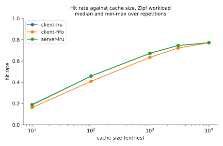
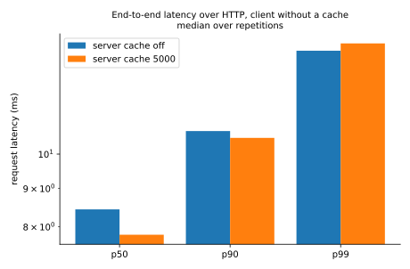
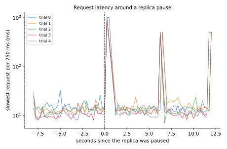
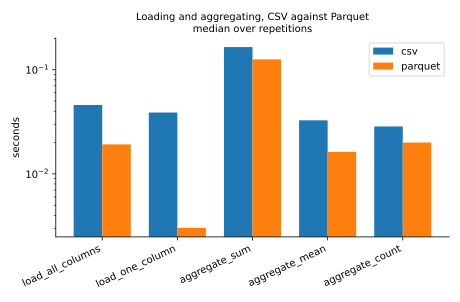
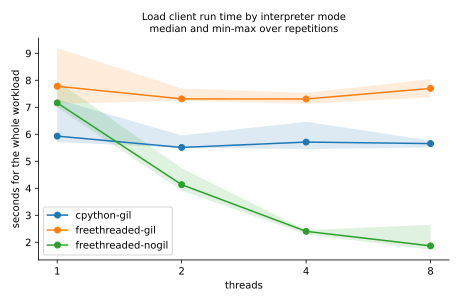
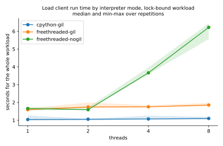

# replicated-lookup-service

This repo is a property lookup service for Madison, Wisconsin. A gRPC dataset tier holds the city's parcel and address data on two replicas. An HTTP cache tier sits in front, alternates between the replicas, keeps an LRU cache, and keeps answering when a replica dies or hangs. The dataset tier exists three times, in Python, Java and Go, and a conformance tool checks that all three return identical answers for every key in the data. There is also a small upload service that accumulates CSV uploads into one table and answers column aggregates from either the CSV or the Parquet copy of each upload.

## Where it came from

This started as a project in CS 544 (Big Data Systems) at UW-Madison. The course version had a Flask cache tier in front of two Java gRPC dataset servers for Madison addresses; we ported the Java server to Python, made the cache alternate between the two servers and retry when one failed, added an LRU cache of six entries, a lookup by zip code, and changed the protobuf reply from a failure flag to an error string without breaking the old Java server. A later project in the course was a performance study: a multi-threaded client with a thread-safe FIFO HTTP cache, Parquet against zipped CSV, hit rate against cache size, and CPython with and without the GIL at 1, 2, 4 and 8 threads. The spring versions had a replicated LRU cache service and a thread-safe CSV/Parquet upload server.

I rebuilt all of it from scratch afterwards as one repo, with my own protobuf contract and code, and added what it needed to run for real. It fetches the city's public data instead of using a file we were given. The dataset server also exists in Go, and the conformance tool replays every key against all three implementations. The cache tier tracks which replicas are down, fails over on a dead replica and on a hung one, and exposes Prometheus metrics. Compose has health checks and memory limits, there is a failure-injection script, Kubernetes manifests that I ran on kind, a CI workflow, and benchmark scripts whose raw results are committed next to this README.

## Layout

    proto/           lookup.proto (current contract), table.proto (upload service)
    proto-v1/        the first lookup contract, frozen; the compatibility tests build a server from it
    python/          lookupsvc: dataset server, cache tier, table service, fetch script, conformance tool, tests
    java/            Gradle project, dataset server and tests
    go/              dataset server and tests
    bench/           load client, one script per experiment, plots, results/
    deploy/          Prometheus config, Kubernetes manifests (kustomize)
    scripts/         proto generation, failover demo, kind download, kind smoke test
    testdata/        a 252-row synthetic dataset shaped like the real one (fixed seed, used by tests and CI)

## The data

`python -m lookupsvc.fetch` downloads two tables from the City of Madison open data portal, tax parcels and address points, and joins them on the parcel id. The address table supplies parcel, street address and zip; the tax table supplies assessed values, lot size, year built and living area. The output is `data/madison.csv.gz` and a Parquet copy, 154,639 rows (`bench/results/formats.meta.json`). Neither file is committed. Address points with no matching tax parcel and repeated addresses on the same parcel are dropped, and the script prints how many. The city publishes the data for informational purposes under its data policy, without warranty; that is the only licence statement I found.

A building with many units has one row per unit address, so a parcel lookup can return many addresses.

## Run it

You need Docker with Compose v2. I used Docker 28.4 on Windows 11 (`bench/results/*.meta.json`).

1. Clone the repo and start the stack:

        git clone https://github.com/muhammad-musa-ml/replicated-lookup-service
        cd replicated-lookup-service
        docker compose up -d --build

   The first start downloads the two city tables, builds `data/madison.csv.gz`, then starts two Go dataset replicas, the cache tier on port 8200 and the upload service on port 8201. `docker compose ps` should show all four services healthy.

2. Ask for things:

        curl localhost:8200/parcel/070922106137
        curl "localhost:8200/zip/53706?limit=2"
        curl "localhost:8200/address?q=1308%20W%20Dayton%20St"
        curl "localhost:8200/street?q=W%20Dayton%20St&limit=1"
        curl localhost:8200/healthz
        curl localhost:8200/metrics

3. Tear it down with `docker compose --profile all --profile monitoring down -v`.

The repo ships a `.env` with `DATASET_IMPL=go` and `COMPOSE_PROFILES=go`. Without it, `DATASET_IMPL` still defaults to go (`docker-compose.yml` says `${DATASET_IMPL:-go}`, so the cache tier looks for `dataset-go-1` and `dataset-go-2`), but every dataset service sits behind a compose profile, so with `COMPOSE_PROFILES` unset no replica starts; run `docker compose --profile go up -d --build` in that case. To use the Java or Python replicas instead of Go, set `DATASET_IMPL` and `COMPOSE_PROFILES` in `.env` to `java` or `py`. `docker compose --profile all up -d` starts all three pairs on host ports 8210-8215 (Python 8210/8211, Java 8212/8213, Go 8214/8215), which the conformance tool and the implementation comparison need.

### The HTTP API

| request | meaning |
|---|---|
| `GET /parcel/<id>` | addresses on one parcel |
| `GET /address?q=<text>` | an exact address, case and extra spaces ignored |
| `GET /street?q=<text>&limit=N` | addresses on a street |
| `GET /zip/<five digits>?limit=N` | addresses in a zip code |
| `GET /healthz` | asks each replica for its health, 503 if none answers |
| `GET /stats`, `GET /metrics` | cache counters as JSON, Prometheus text |

`limit` defaults to 100 and goes up to 5000. Every answer has the same shape. This is the first command above:

    {"attempts":[],"error":"","properties":[{"address":"1308 W Dayton St","assessed_improvement":82800,"assessed_land":0,"assessed_total":82800,"living_area":0,"lot_size":161045.67,"parcel":"070922106137","street":"W Dayton St","year_built":2024,"zip":"53706"}],"returned":1,"source":"dataset-go-1","total":1}

`source` is the replica that answered, or `cache`. `attempts` lists replicas that were unreachable before one answered. `total` is the number of matches before `limit` cut the list: the zip request above returns 2 properties and `"total":3379`. A parcel that does not exist gives HTTP 404 with `"error":"no addresses found"`, a malformed key gives 400, no reachable replica gives 503, and a replica that does not support the lookup gives 501. Errors are never cached; asking for the same parcel twice shows `"source":"cache"` the second time.

### The upload service

The upload service accumulates CSV uploads into one table. The first upload fixes the column names and types; later uploads must match. Each upload is stored as the CSV that arrived and as Parquet, and an aggregate (sum, mean or count) can be computed from either copy. Set up the Python client once:

    python -m venv .venv
    . .venv/bin/activate              # .venv\Scripts\activate on Windows
    pip install -e "python[cache,dev]"
    python scripts/gen_proto.py

Then:

    printf 'id,price\n1,10.5\n2,20\n' > a.csv
    printf 'id,price\n3,4.5\n' > b.csv
    python -m lookupsvc.table.client upload a.csv b.csv
    python -m lookupsvc.table.client aggregate price sum --format csv
    python -m lookupsvc.table.client aggregate price mean --format parquet
    python -m lookupsvc.table.client info

This prints `a.csv: upload 0, 2 rows, table now 2`, then `b.csv: upload 1, 1 rows, table now 3`, then `sum(price) = 35 over 3 values in 2 uploads`, `mean(price) = 11.6667 over 3 values in 2 uploads` and `2 uploads, 3 rows, columns: id, price`.

The server is multi-threaded. One lock guards the schema, the id counter and the list of committed uploads; parsing, file writes and column scans happen outside it, and an upload becomes visible all at once when it commits. `python/tests/test_table.py` runs the same eight-way concurrent upload twice, once with the lock and once with a no-op lock plus a deliberately slow id counter, and asserts that the second one corrupts the table (duplicate ids, overwritten files).

## How failover works

The cache tier keeps a gRPC channel per replica and starts each request at the next replica in the rotation. If a replica answers UNAVAILABLE (dead) or DEADLINE_EXCEEDED (hung, or one that never answers), the call moves to the next replica; each replica is tried at most once per request. The replica is then skipped for 5 seconds, and after that it is tried again with a 0.5 second deadline instead of the full one (1 second by default, `UPSTREAM_TIMEOUT`). Any other gRPC error is returned as a 502 without trying another replica. Only the four lookups are ever retried like this; the balancer refuses other methods, and the upload service is not behind it.

`scripts/failover_demo.sh` shows it: it sends requests for distinct parcels, stops `dataset-go-1`, keeps sending, starts it again and prints which replica answered each one. With nothing else going on, the first request after the stop is one slow request that lists the stopped replica in `attempts`; the rest go to the other replica; after the restart the answers alternate again.

## The protobuf change and how compatibility is tested

The first contract (`proto-v1/lookup_v1.proto`) marked failures with `bool failed`. The current one (`proto/lookup.proto`) adds an `error` string, a `total` count, a `limit` on street and zip requests and a new `ByZip` call. Field 2 (`failed`) stays, marked deprecated, and current servers set both: an old client still sees `failed`, and the cache tier reads `error` but treats an empty failed reply from an old server as "not found".

`python/tests/test_contract_compat.py` builds a server from the frozen v1 file and points the current cache tier at it (found, not found, no zip support giving 501, the limit applied by the cache tier because the old server ignores it). It also runs a client built from the v1 file against a current server. The v1 server and client run in subprocesses because both contracts use the package name `lookup` and cannot be loaded into one Python process.

## Conformance

With all three pairs running:

    python -m lookupsvc.conformance --dataset data/madison.csv.gz \
        --target python=localhost:8210 --target java=localhost:8212 --target go=localhost:8214

It replays every parcel, address, street and zip in the file, plus altered spellings (upper case, padding) and keys that match nothing, with and without limits, against each target, compares the serialized replies byte for byte, and exits 1 on any difference or failed call. The run in `bench/results/conformance.txt` made 232,892 requests to each of the three implementations: 0 differences, 0 errors, 658 seconds.

## Prometheus and Kubernetes

`docker compose --profile monitoring up -d prometheus` starts a Prometheus on port 8220 that scrapes the cache tier every 5 seconds. The cache tier exports hit and miss counters, an HTTP latency histogram per endpoint, gRPC errors per replica and code, lookups answered per replica, and the number of cache entries.

`scripts/get_kind.sh` downloads kind and kubectl into `.tools/` and checks each against its published sha256 before making it executable. `scripts/k8s_smoke.sh` creates a kind cluster, loads the images, applies `deploy/k8s` (a StatefulSet of two Go dataset pods behind a headless service, two cache pods, one upload pod), deletes a dataset pod while requests flow, and deletes the cluster. I ran it on kind v0.33.0 and requests kept succeeding with the pod gone, and went back to alternating once it returned. The pods serve the synthetic fixture rather than the Madison data, and I have no recorded result for this beyond the script.

## Tests

    python -m pytest python/tests bench
    RLS_INTEGRATION=1 python -m pytest python/tests/integration
    docker run --rm -v "$PWD":/src -v rls-gocache:/go/pkg golang:1.26-bookworm sh /src/go/test_in_docker.sh
    docker run --rm -v "$PWD":/src -v rls-gradle:/home/gradle/.gradle gradle:9.8.1-jdk21 sh /src/java/test_in_docker.sh

The first line needs the Python setup from the upload section. The second brings up the compose stack on the synthetic fixture and checks it from outside: lookups and the cache, metrics, all three implementations against each other, traffic with a replica stopped, and the upload service. It needs ports 8210-8215, 18200 and 18201 free. With Go 1.25 or a JDK 21 installed you can run `go/gen.sh` then `go test ./...` in `go/` and `./gradlew test` in `java/` instead of the containers. On Linux the `$PWD` mounts work as written; in Git Bash on Windows I ran them from PowerShell with the full path. `.github/workflows/ci.yml` runs the same steps; I have not seen it run on GitHub.

Some of the tests exist because I broke the code on purpose to see them fail: caching errors, retrying on every gRPC error, and an LRU that ignores an overwrite each make one or more tests fail.

## Results

All of this was measured on one Windows 11 laptop (13th Gen Intel Core i7-13700HX, 24 logical CPUs, 29.7 GiB of memory, Docker Desktop with a 14.5 GiB VM). The machine was not idle: nine containers from other projects were running but doing nothing, CPU busy was between 7 and 40 percent in the five samples before the pass, and free memory was 1.3 GiB (Windows was caching the rest). `bench/results/machine_state.txt` has the snapshots from before and after. The load client runs on the host and talks to containers through Docker's port forwarding, so absolute latencies include that.

`bench/run_all.sh` ran everything in one go in about 73 minutes (01:31 to 02:44 UTC on 2026-10-13); the failover experiment was run again afterwards, see below. Each experiment writes a CSV, a `.meta.json` with the command, commit and machine, and an SVG into `bench/results/`. `bench/summarize.py` turns the CSVs into `bench/results/summary.md`, and every number below comes from that file. Every figure is the median of 5 repetitions with the minimum and maximum in parentheses. The `commit` in the meta files ends in `+dirty` because the results folder was untracked while the runs were going.

### Hit rate against cache size

`python bench/run_hitrate.py`. Each run replays 30,000 requests for parcel ids drawn with a Zipf-like skew (exponent 1.1) over the 71,201 distinct parcels, with a different seed per repetition. "server LRU" is the cache tier's own cache, one fresh container per run, hit rate read from its counters, with 4 client threads and no client cache. The two client series are the load client's own cache, single thread, no network.

| cache size | server LRU | client LRU | client FIFO |
|---|---|---|---|
| 10 | 0.1861 (0.1850-0.1891) | 0.1896 (0.1877-0.1927) | 0.1618 (0.1599-0.1640) |
| 100 | 0.4575 (0.4565-0.4589) | 0.4576 (0.4563-0.4627) | 0.4089 (0.4062-0.4112) |
| 1000 | 0.6720 (0.6693-0.6732) | 0.6716 (0.6706-0.6738) | 0.6341 (0.6339-0.6348) |
| 3000 | 0.7447 (0.7430-0.7462) | 0.7449 (0.7443-0.7463) | 0.7211 (0.7203-0.7216) |
| 10000 | 0.7713 (0.7694-0.7716) | 0.7713 (0.7695-0.7716) | 0.7713 (0.7695-0.7716) |

The two LRU implementations (written separately, one behind HTTP and one in the load client) agree to within the spread, which I take as a check on both. LRU beats FIFO at every size up to 3000. At 10000 all three series are identical, which means the cache already holds every parcel the workload touches and the eviction policy no longer matters; the curve is flat because there is nothing left to gain, not because the cache stopped working.

### Latency with and without the cache

`python bench/run_latency.py`. A fresh cache-tier container per run, 2,000 warm-up requests then 20,000 measured, same Zipf workload, 4 client threads, no client cache, so every request is a full HTTP round trip. Latency in milliseconds, requests per second in the last column.

| cache tier cache | p50 | p90 | p99 | requests/s | server hit rate |
|---|---|---|---|---|---|
| off (size 0) | 8.44 (7.95-8.54) | 10.73 (10.20-10.86) | 13.74 (13.21-13.94) | 463.2 (456.7-487.6) | 0 |
| 5000 entries | 7.81 (7.47-8.04) | 10.51 (10.37-10.91) | 14.05 (13.94-14.74) | 495.2 (480.9-512.9) | 0.768 (0.767-0.769) |

The cache answers about 77 percent of requests and the median drops by about 0.6 ms; p99 does not improve. I expected a bigger difference. The dataset call is a lookup in an in-memory map, so a cache hit saves very little next to the HTTP handling itself. I did not profile the cache tier. My guess is that its single gunicorn worker (16 threads, one Python process) is what limits it to roughly 460 to 500 requests per second here, and that is also why the language comparison below shows nothing.

### Does the dataset server's language matter

`python bench/run_impls.py`. The same workload as above with the cache tier's cache off, against the Python, Java and Go replica pairs in turn; repetitions are interleaved (py, java, go, py, ...) so drift in the machine does not line up with one implementation.

| dataset server | p50 | p90 | p99 | requests/s |
|---|---|---|---|---|
| Python | 7.88 (7.51-8.55) | 10.93 (10.27-11.71) | 14.30 (13.57-15.04) | 487.9 (451.9-512.6) |
| Java | 7.89 (6.84-8.46) | 11.18 (9.66-11.48) | 14.72 (12.84-15.49) | 485.7 (456.8-557.0) |
| Go | 7.46 (7.25-8.15) | 10.48 (10.17-11.58) | 14.16 (13.36-15.47) | 512.6 (470.5-526.9) |

No errors in any run. The differences between the three are inside the run-to-run spread, so at this load, through this cache tier, the implementation language does not matter. Go has the lowest median and the highest throughput, but the ranges overlap. This says nothing about the dataset servers under heavier load or with a faster front end; it only says the front end is the bottleneck here.

### A replica stops, or hangs

`python bench/run_failover.py` and `python bench/run_failover.py --how pause --out failover_pause`. A closed-loop client with 4 threads and no cache (Zipf exponent 0.8, cache tier cache off) runs for 20 seconds per trial, 5 trials. At about 8 seconds the first Go replica is stopped (`docker compose stop`) or paused (`docker compose pause`, so connections stay open and nothing answers). Slow means a request over three times the p99 measured before the failure. The "seen by cache tier" column comes from the cache tier's own metrics.

| | errors | baseline p99 ms | max latency ms | slow requests | recovery s | errors the cache tier saw from the replica |
|---|---|---|---|---|---|---|
| stopped | 0 in all 5 trials | 12.0 (11.8-16.6) | 27.8 (21.0-34.2) | 0 | 0.00 | 3 (3-4) |
| paused | 0 in all 5 trials | 12.5 (10.5-15.3) | 1011.6 (1009.2-1015.6) | 12 (12-12) | 12.40 (12.34-12.43) | 12 (12-12) |

A stopped replica costs nothing visible under load: no client errors, no request slower than 34.2 ms, and the cache tier saw only three or four refused calls before it stopped sending traffic there. The connection is refused immediately, so the next replica is tried at once. The demo script, which sends a single request right after the stop, does show one slower request.

A paused replica costs one deadline. The slowest request is 1.01 s, the default 1 s upstream deadline. There are 12 slow requests in every trial and the cache tier recorded 12 deadline errors, which is 4 client threads times 3. In `failover_pause_events.csv` the slow requests of trial 0 come in three groups of four: at 8.4 s (1.01 s each, the full deadline), at 14.4 s and at 19.9 s (0.51 s each, the probe deadline). So the four client threads that reach the paused replica first each wait out the deadline, the replica is then skipped for 5 seconds, and every time the cooldown ends it is probed once more; the replica stays paused until the trial ends, so it fails every probe. "Recovery" is 12.4 s only because the replica never comes back during a trial: it is the time from the pause to the end of the last probe.

Two things to know about these numbers. I first wrote the balancer to fail over only on UNAVAILABLE. A smoke run with a paused replica showed client errors (502s) and 2 s stalls, which is why it now fails over on DEADLINE_EXCEEDED as well; the smoke run is not in the results and every figure here is from after that change. And the failover experiment was run twice: once inside `run_all.sh` and again afterwards because I added the cache-tier counters to the script. Both runs had zero errors; the committed files are from the second run.

### CSV against Parquet

`python bench/run_formats.py`. In one process on local disk, file cache warm, 154,639 rows. "Load" reads the gzipped CSV and the Parquet copy with pyarrow. The upload test splits the data into 8 uploads, sends them to a fresh table store (every upload is parsed and written as CSV and as Parquet), then runs aggregates against the CSV copies and against the Parquet copies. Seconds.

| task | CSV | Parquet |
|---|---|---|
| load all columns | 0.0458 (0.0416-0.0544) | 0.0192 (0.0160-0.5432) |
| load one column | 0.0388 (0.0370-0.0436) | 0.0030 (0.0025-0.0034) |
| sum of an integer column over all uploads | 0.1651 (0.1381-0.1680) | 0.1257 (0.1223-0.1513) |
| mean of a float column | 0.0326 (0.0286-0.0412) | 0.0162 (0.0140-0.0232) |
| count of a string column | 0.0285 (0.0241-0.0381) | 0.0200 (0.0173-0.0240) |

Uploading all 8 parts (both formats written) took 0.2066 s (0.1744-0.2183). The gzipped CSV is 1,810,396 bytes and the Parquet copy 1,692,280. The per-upload copies come to 15,492,531 bytes of uncompressed CSV against 3,014,402 bytes of Parquet.

Reading one column is about 13 times faster from Parquet, since it reads only that column; reading everything is about 2.4 times faster. The 0.5432 s maximum for Parquet is the first repetition, a cold read, and the median is not affected. Aggregates favour Parquet by less, between 1.3 and 2 times; the sum is also the slowest of the three aggregates in both formats, and since it runs first in each repetition and on a different column I cannot separate warm-up from the column type. The CSV side reads the stored upload files with the table's column types, so it parses every row of the one column it needs.

### GIL against free-threaded CPython

`python bench/run_threads.py --ft-python <python3.13t>` and the same with `--requests 1000000 --keys 5000 --cache 5000 --passes 1 --out threads_lockbound`. The load client runs in local mode with no network: a shared bounded cache with one lock, JSON decoding of each document that misses, and a sum over the result. Three interpreters: a regular CPython 3.13.5 (the GIL), and a free-threaded 3.13.7 build run once with the GIL forced on (`-X gil=1`) and once with it off (`-X gil=0`). The runs check that each interpreter reports the mode it was asked for and that every run produces the same checksum. The standard and free-threaded builds are different patch versions.

The first run is the default: 100,000 requests over 20,000 keys with a cache of 200 entries and 50 JSON decode passes per miss, so most requests miss and decode, which is CPU work outside the lock. Seconds for the whole workload:

| threads | CPython, GIL | free-threaded, GIL on | free-threaded, GIL off |
|---|---|---|---|
| 1 | 5.93 (5.71-7.29) | 7.78 (7.13-9.19) | 7.16 (6.99-7.97) |
| 2 | 5.51 (5.50-5.96) | 7.31 (7.24-7.69) | 4.13 (3.91-4.74) |
| 4 | 5.71 (5.45-6.46) | 7.31 (7.13-7.54) | 2.40 (2.29-2.45) |
| 8 | 5.65 (5.51-5.77) | 7.70 (7.37-8.04) | 1.86 (1.72-2.64) |

With the GIL off, 8 threads are 3.84 times faster than 1 thread (7.16 s against 1.86 s). With the GIL on, in either build, adding threads does nothing (1.05 times at 8 threads on the regular build).

The second run is the opposite case: 1,000,000 requests over 5,000 keys with a cache of 5,000 entries and one decode pass, so almost every request is a hit and the work is the cache lock itself.

| threads | CPython, GIL | free-threaded, GIL on | free-threaded, GIL off |
|---|---|---|---|
| 1 | 1.04 (0.97-1.27) | 1.59 (1.57-1.66) | 1.66 (1.55-1.75) |
| 2 | 1.06 (0.99-1.08) | 1.75 (1.69-2.00) | 1.59 (1.57-1.72) |
| 4 | 1.07 (1.04-1.25) | 1.75 (1.71-1.84) | 3.66 (3.58-3.97) |
| 8 | 1.10 (1.03-1.19) | 1.85 (1.78-1.98) | 6.22 (5.56-6.45) |

Here the GIL-off build gets slower as threads are added: 8 threads take 6.22 s against 1.66 s for one, 0.27 times the speed, while the regular build stays flat around 1.1 s. So whether free-threading helps depends entirely on how much of the work sits outside a shared lock. When the threads mostly queue on the one cache lock, running them truly in parallel makes the contention worse; I did not profile why it gets this much worse than the GIL builds. The first table is what people usually hope for, and the second is what a hot shared cache looks like. Neither is a general statement about free-threaded Python, only about this client and these parameters. The free-threaded build is also slower on one thread in both runs (7.78 s against 5.93 s in the first, 1.59 s against 1.04 s in the second).

## Limits

- Everything ran on one machine, with the load client on the host and the services in Docker Desktop, so none of the latencies say anything about a real network. The machine was not quiet in the strict sense (see the snapshot above), and I did not repeat the whole pass.
- The dataset tier is in memory and the dataset is small, 154,639 rows. The cache tier is one gunicorn worker with 16 threads, so each container has one cache, it is bound by one Python process, and running several cache pods means several separate caches.
- Failover covers lookups only. A replica that is slow but not hung (answering just under the deadline) is not treated as down. With every replica down, the answer is a 503 after up to one deadline per replica.
- The upload service is one process with an in-process lock and is not something to scale out. Its aggregate sums are float64. Schemas are fixed by the first upload.
- Address matching is exact after lower-casing and collapsing whitespace. Key normalisation is ASCII only and the three servers share it by agreement, checked by the conformance tool only on this data.
- The Kubernetes manifests were run on kind with the synthetic fixture, once, without recorded numbers. The CI workflow has not been run on GitHub.
- The GIL comparison compares two patch versions of CPython 3.13 and two hand-picked workloads. The decode-pass count in the first one is a knob I chose so that there would be CPU work outside the lock.
